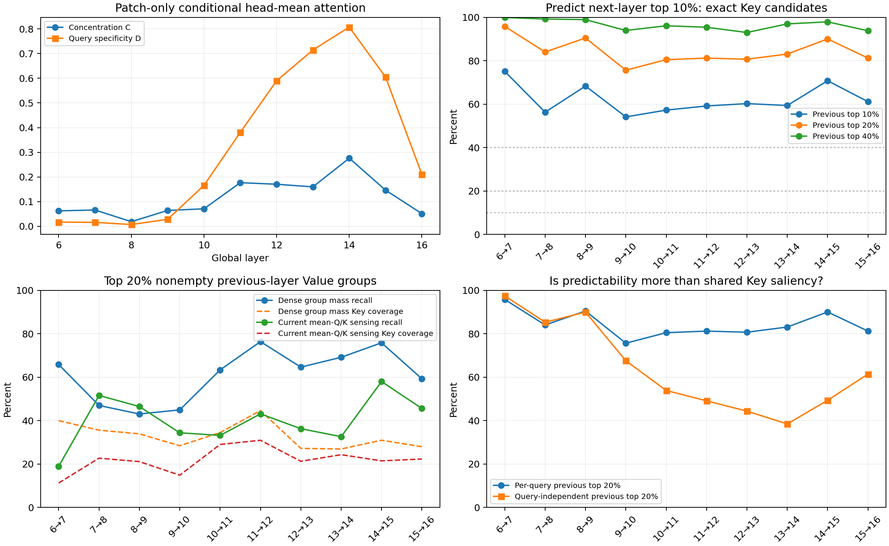

# Dense attention的跨层结构形成诊断

结果目录：[`outputs/attention_formation/chess_gap10`](../../outputs/attention_formation/chess_gap10)。

本实验仅诊断原始Dense VGGT，不改变稀疏模型或A/V分配。输入为7Scenes Chess
seq-01第0、10帧；0-based global层L6–16；每层16个head各自softmax后平均。

## 结论

L9并非没有L10的先验：其Top10/20/40%候选分别召回L10 Top10%边的
54.11/75.62/93.91%。但精确support重合率不是随深度单调增加。
Query-specificity D从L9的0.0282逐渐升至L14的0.8073，支持从公共Key显著性
向Query-specific结构转变。集中度C在L10→11和L13→14有跃升，但并不单调。

当前平均Q/K、Value粗分组的候选预测明显较弱。例如L9→10，前20%非空组：
按Dense组质量排序召回44.90%（覆盖28.40%Key），按当前mean-Q/K粗感知排序
召回34.36%（覆盖14.84%Key）。历史中有用的信息不等于现有cheap sensing能提取出来。
不能据此认定Value coarse regions更稳定，也不能把L10固定为普遍bootstrap层。

这只是两帧单场景观察，不是128帧、多场景验证，也不是最终稀疏推理精度或速度结果。



- [完整指标表与定义](../../outputs/attention_formation/chess_gap10/report.md)
- [解释与局限](../../outputs/attention_formation/chess_gap10/interpretation.md)
- [Patch指标CSV](../../outputs/attention_formation/chess_gap10/patch_metrics.csv)
- [含特殊token的对照CSV](../../outputs/attention_formation/chess_gap10/all_token_metrics.csv)
- [24层Dense注意力概览](../../outputs/global_attention/chess_gap10_layer_mean_all24/all_layers.png)

## 复现

从仓库根目录运行，需可用GPU、仓库既定模型环境、本地checkpoint及7Scenes数据。
仓库不上传输入数据、checkpoint和约397MiB完整FP32矩阵；保存结果表、曲线、
粗分组缓存和源矩阵哈希。下面第一步可重新生成全部24层2082×2082矩阵：

```bash
PYTHONPATH=. CUDA_VISIBLE_DEVICES=0 python scripts/visualize_layer_mean_global_attention.py
PYTHONPATH=. CUDA_VISIBLE_DEVICES=0 OPENBLAS_NUM_THREADS=4 python scripts/analyze_attention_formation.py
PYTHONPATH=. python -m pytest tests/test_attention_formation.py -q
```

可视化脚本默认拒绝覆盖已有`result.json`；在已有结果目录重跑时，请用
`--output-dir`指定新目录，并将其传给分析脚本的`--source`。
粗分组缓存对应本次Dense轨迹；改变输入、checkpoint或分组参数时须使用新分析输出目录。

主指标涵盖全部2072个patch Query和Key，排除10个special token后逐行归一化，
K=207，候选数为207/414/828。附表保留所有2082个token，K=208，结论一致。
Coarse排序不使用下一层权重或分组，目标始终映射到source层的同一分组；
同时记录实际Key覆盖率，避免把20%组误认为20%Key。
Dense分组hook未改变模型pose输出（逐bit一致）；3项统计函数单测通过。
