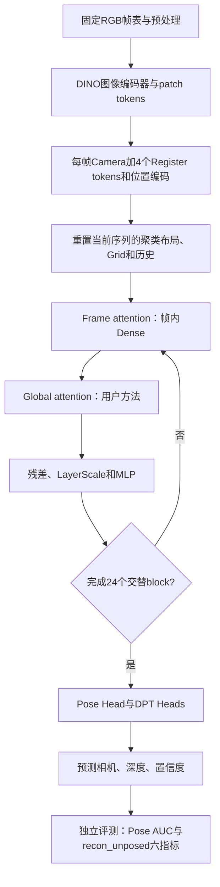
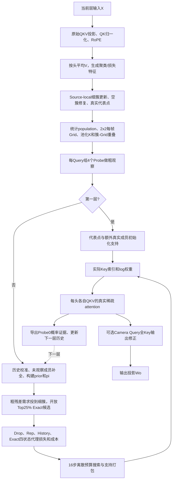

# 当前用户方法：完整流程、ETH3D退化证据及同步边界

## 1. 先明确方法与状态

本文描述用户的 Value 聚类、共享状态损失、跨层历史复用、残差预算分配方法。
它的入口是 `install_reuse_residual_exploration`，不是原 SAF3R 的逐头 profile 路由。

- 用户方法与诊断分支：`codex/eth3d-regression-repair-20261105`。
- 另一个 `codex/eth3d-speed-fix-20261105` 分支包含 SAF3R 分组执行参考实验。
  其 ETH3D F1=63.56%、7Scenes耗时=7.91s **不能作为用户方法已修复的结果**。
- 当前没有在用户方法内部完成同时满足精度与严格不降速要求的修复。
- 本次同步不覆盖远程 main，也不混入主工作区其他未提交修改；不重新启动实验。
- 后续计算仅允许 GPU4、5、6。历史运行中的 GPU3 来源保留，不改写。

## 2. 配置版本必须分开

| 项目 | 保留的工作流默认配置 | 退化集成实验 main |
|---|---|---|
| 文件 | `configs/evaluation/reuse_shared_value_loss_q256.json` | `outputs/integrated_quality_speed_20261105/frozen_configs/main.json` |
| 保留预算 | 均匀20% | 前6层10%、中12层22%、末6层10%，均值16% |
| fine cluster数量 | 由基础预算决定 | patch数的12% |
| Lloyd更新 | 2次 | 1次 |
| 执行权重 | unit，关闭population compensation | cluster_population |
| Camera Query额外全Key输出 | 无 | 每帧1个Camera Query |
| Value特征 | head_mean | head_mean |

16%预算及上述联合改变是集成实验的配置，**不是用户方法的必要定义**。
不能把集成实验的退化直接归因为用户原始方法本身。多项设置同时变化，也不能从
两行最终分数反推其中某一项就是唯一原因。

## 3. 完整模型流程

编码器、Frame attention、投影、残差/MLP、预测Heads保留原checkpoint。
用户方法替换的是24个 Global attention 的稀疏选择及其历史机制。
离线真值对齐、融合和重建评测不参与推理路由或调参。

## 4. 每层 Global attention 的内部流程

### 4.1 Token与预算

设帧数为 `F`、每帧patch数为 `P`，则全局token数 `N=F*(P+5)`。
默认保证每帧5个特殊Key；这是Camera/Register tokens，不是首帧全部patch。

每层可选patch预算为：

`B_l = floor(retention_l * N) - protected_key_count`。

保留率计入特殊/保护Key，不是只对patch计算。若启用 `protect_first_frame`，
首帧patch进入保护库、退出聚类域，并从同一总预算扣除。该选项默认关闭；
它是一个显式方法变体，预算不足会报错，不自动提高保留率。

### 4.2 Query分组与聚类

集成main的Query组大小为256，相同组内Query共用一份支持Key和权重。
`attention_block_queries=64` 是执行tile，不等于选择器Query组大小。

聚类和损失的特征为 `mean_h(V_h)`；**最终attention仍使用每头自己的Q/K/V**，
不是把实际V替换成跨头均值。风险来自据此选择的支持及代理损失信息不足。

`source_width=32` 表示固定source内的fine-cluster候选规模，不是32个patch。
source成员域在一次forward内固定；域内成员可换fine cluster，昨天的代表点也可换簇。
进行质心分配、临时空簇修复，再选距质心最近的真实token作为代表。
main中fine cluster数固定为patch数的12%；逐层预算变化不等于簇数同步变化。

源码：`saf3r/patch/source_local_unanchored.py`，
`saf3r/patch/reuse_residual_exploration.py::reset/forward`。

### 4.3 粗观察、历史与残差候选

每帧划分2x2 canonical Grid，按Grid池化每头K。每个Query组取4个位置Probe。
M5c粗概率包含特殊Key归一化；残差候选的patch-Grid概率采用patch域归一化。
两种归一化域不是同一个量，不应混用解释。

`history_mode=dense_m5c` 是历史校准公式的名字，**不表示每层执行Dense NxN attention**。
实际证据来自稀疏attention的Probe0、head-mean概率与Grid级补全。

main的 `history_query_interval/query_group_size=256/256=1`：每个Query组都有一个
实际历史Probe，但只覆盖组内1/256个Query。不能误写成main仅采样1/8组；
那是Query组32、interval256配置的情形。

跨层根据当前/上一层粗概率比例形成beta：需求下降用ratio，需求上升用ratio^-2。
对已观察Key重建历史概率，未观察成员使用本Grid内的均匀补全，汇聚为簇质量pi。
粗残差需求通过簇-Grid重叠矩阵投到细簇，Top25%簇允许Exact状态。

源码：`reuse_probe_cache.py`、`reuse_direct_coarse_observation.py`、
`reuse_sampled_history.py`。

### 4.4 四状态、预算与执行权重

共享状态路径使用归约后的Cluster×Grid平方L2统计，构造四个状态：

| 状态 | 输出的真实Key | 成本 |
|---|---|---:|
| Drop | 不输出该簇patch Key | 0 |
| Rep | 代表点 | 1 |
| History | 本层合格的历史Key集合 | 实际合格Key数 |
| Exact | 整簇成员，仅残差候选可选 | 簇population |

16步Lagrange预算搜索选择可行离散组合，不声称是精确背包最优解。
打包成真实token索引后，main的 `cluster_population` 将簇population平均分给
该簇输出的Key，再用 `log(weight)` 加到attention logits。
因此main的History权重不保证为1；不要套用另一个 `rep_population` 变体的解释。

真实稀疏attention仍逐头计算：

`y_h(q)=sum_{j in support(q) union protected} softmax(q_h*k_h/√d + log(w_j))*V_h(j)`。

特殊Key默认unit权重。Drop簇的贡献不会自动完整迁移到其他簇。
代理损失不是最终Pose/点云误差的严格上界，population补偿也不保证恢复原Dense softmax。

源码：`reuse_window_graph.py`、`saf3r/triton/reuse_shared_value_states.py`、
`shared_value_repair.py`、`saf3r/triton/reuse_direct_sampled_probability.py`。

### 4.5 Camera输出修正与历史闭环

main额外用全Key计算每帧Camera Query的输出，随后做Wo投影。
历史证据仍来自普通稀疏执行；Camera输出修正不会倒写为Dense历史证据。
下一层消费当前支持ID、Grid摘要和FP16去偏log概率缓存；下一序列重置历史。
Graph只复用结构，当前层的几何统计、prior、历史和候选每次更新。

## 5. 退化证据：哪些已证实，哪些仍是假设

| 位置/问题 | 已有证据 | 结论边界 |
|---|---|---|
| 集成main预算降低和深层覆盖 | 相比保留的20%默认，main均值16%，末6层只有10%；pipes实际保留15.96%，SAF3R为20.20% | 配置/比较预算确实不同，但跨方法预算差异本身不能证明唯一因果；需要用户方法内单因素预算控制 |
| 首帧patch未受保护 | 同总Key cap下，pipes首帧保护变体对独立Dense的旋转偏差4.44°→2.02°，平移方向偏差22.41°→5.00° | 支持首帧信息不足是贡献因素；heads32深度/平移并非都改善，不是全部原因 |
| 局部误差校准盲点 | Camera局部同QKV误差约0.3%，独立Dense中层Camera特征偏差达10%级；Dense重复前向一致 | 校准确实不能证明跨层保真；不能把0.3%理解成Pose精度损失仅0.3% |
| head_mean特征 | 不同头相反方向差异可在均值中抵消；head_concat在部分场景改善，但也有反例 | 信息损失风险明确，尚未证明是全数据集首要/唯一根因 |
| 256 Query共享支持、每组单Probe历史 | 代码确认；缩小组、增加聚类迭代、增加Dense特殊Query均无一致收益 | 代表性不足是待验证机制，不能直接归咎其中某个参数 |
| 代理损失与执行权重 | loss使用共享Value/估计概率；执行使用每头真实K、softmax与population偏置 | 目标与真实attention/重建之间缺少保真保证；需要逐状态Dense反事实误差与计权控制 |
| 跨层历史反馈 | prior使用上一层稀疏证据和未观察成员补全，布局还会跨层更新 | 有误差反馈通道；尚未用独立teacher-history控制定量分离其贡献 |
| 数值非确定性 | 同一配置重复前向也出现约0.5%Pose、约1%深度相对L2变化 | 不能据缓存配置间同量级差异断言缓存语义出错；不足以解释数十个百分点F1下降 |

两个当前Dense控制的质量已复现：pipes F1=81.66%，playground F1=73.50%。
相同checkpoint、帧表及协议下，退化main分别为34.40%、20.65%左右。
这排除了“仅由旧参考/环境漂移造成巨大差距”的解释，**不等于已定位某一个代码bug**。
目前未发现足以解释退化的支持越界、重复Key或预算违规。

把“换成SAF3R路由后分数变好”当作用户方法内部根因已修复，是此前判断错误。
该结果只能说明另一条方法路径表现不同，不能替代上述因果分离。

## 6. 速度退化与精度退化分开

已定位一项用户方法内部可修的实现开销：Shared-Value选择器只消费归约统计，
Graph却曾为每个缓存窗口复制完整N×feature_dim的z。head_concat显著放大该冗余，
触发2GiB缓存上限、反复淘汰与重捕获。删除未使用副本已通过Graph/eager一致性测试。
这解释了一部分运行耗时，**不解释ETH3D精度下降**。

每层另有聚类、pool/overlap、粗观察、prior重建、候选topk、离散求解、支持打包、
历史导出和检查；这些都属于完整前向成本，不能只报attention kernel时间。
GPU kernel分组、缓存和allocator改动是否能直接迁移到用户方法，需要在其完整流程
中计时验证。SAF3R分组版本的7.91s不能拿来证明用户方法也能达到该耗时。

## 7. 现有用户方法结果的读取方式

所有完整质量运行均有AUC@3、AUC@30、ACC、Comp、CD、F1；AUC/F1原始为fraction，
距离为米，CD=(ACC+Comp)/2且使用非平方距离。
7Scenes为全7场景，ETH3D为全11场景等场景宏平均，输入/协议审计保存在各报告中。

- 退化main/fast：`outputs/integrated_quality_speed_20261105/reports/`。
- 首帧保护+head_concat候选：`outputs/eth3d_repair_20261105/reports/`。
- 保留用户主体的紧凑特征候选fast_repair：`outputs/eth3d_repair_20261105/reports_fast/`。
- 独立Dense轨迹、首帧/Camera/Query组/聚类消融：同目录下的`trajectory_*`、`anchor_*`、`anchor2_*`、`sketch_*`。
- 数值/内核/计时诊断的六项几何分数为N/A，不能称为完整质量评测。

fast_repair同批7Scenes完整前向为9.5897s，原SAF3R为9.0029s，原Dense为17.5044s；
相对Dense为1.8253x，较SAF3R慢6.52%。它满足最初10%上限，但不满足严格不降速目标。
此前9.50s属于另一历史batch，不能与该batch拼成配对提速结论。

当前状态：保留并同步用户方法、配置、所有已有证据；修复尚未完成。
后续需要在用户方法内部做预先冻结的单因素/teacher-history/状态计权控制；
本次同步不执行这些新实验，不按7Scenes测试真值选参。

## 8. 用户方法内完整候选的六指标汇总

下表是等场景宏平均，AUC/F1为百分数，ACC/Comp/CD为米；两套数据集分别要求7/7、11/11完整场景。

| 数据集 | 候选 | AUC@3 | AUC@30 | ACC | Comp | CD | F1 |
|---|---|---:|---:|---:|---:|---:|---:|
| 7scenes | 退化集成main | 22.167% | 84.056% | 0.137858 | 0.124579 | 0.131219 | 46.993% |
| 7scenes | 首帧保护+head_concat | 22.624% | 84.100% | 0.139651 | 0.123345 | 0.131498 | 47.432% |
| 7scenes | 首帧保护+独立头sketch4 | 21.892% | 83.899% | 0.139708 | 0.123243 | 0.131476 | 46.966% |
| eth3d | 退化集成main | 12.276% | 67.005% | 0.415724 | 1.110314 | 0.763019 | 42.649% |
| eth3d | 首帧保护+head_concat | 17.388% | 74.689% | 0.383356 | 0.927922 | 0.655639 | 51.338% |
| eth3d | 首帧保护+独立头sketch4 | 16.659% | 73.369% | 0.374640 | 0.906272 | 0.640456 | 53.262% |

这些候选保留用户方法主体；六指标完整并不代表通过最终性能/质量门槛。
首帧保护+head_concat和main在各自batch没有获准的同批Dense暖机计时，其配对加速为N/A。
sketch4候选的同批Dense加速为1.8253x，但相对SAF3R仍慢6.52%。
