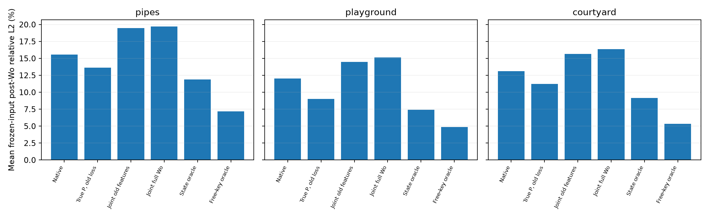

# 全局Key预算下的Oracle与状态损失诊断

每个case联合优化整个Query组的mask：所有cluster共同竞争同一个全局patch Key预算。
不预设每簇保留几个Key。保护Key始终保留；使用同一cluster_population执行算子。
3个ETH3D场景，每场景Global层6/11/13/19、2个Query组，共8个case。组内全部稀疏执行Query、全部head和完整Wo参与真实输出误差；排除本来就由Dense覆盖的Camera Query。
Oracle是真实Dense QK上的近似组合搜索：40步straight-through Adam，状态空间2个起点，自由Key空间3个起点，报告所有硬mask中的最优值；不保证组合全局最优，不进入推理。

## 确认并修复的实现错误

`residual=sparse.mm(...).T`生成列连续张量，`zeros_like(residual)`保留该布局；原state-loss Triton按`group*F+cluster`读取allowed，误读了Exact候选。
旧pipes第6层group12：129个逻辑上禁止的整簇支持实际被执行；冻结输入的eager和Graph完全一致，排除Graph专有缓存错误。386个被禁止的Exact状态被赋有限损失。
修复：候选掩码直接按行连续分配（没有额外copy），同时状态损失kernel读取真实stride；新的规则测试覆盖普通/bounded两种kernel和转置mask。
此前改变簇数等参数也会改变错误读取的映射，故那些收益不能再单独当作簇数压缩是普适根因的证据。

## 状态损失定义本身也有不一致

令History恰为{Rep}。当前cluster_population执行中，两状态都保留同一Key、权重population、成本1，实际输出完全相同，但损失分别为`sum p_j ||V_j-V_rep||²`和`sum_{j不在History} p_j ||V_j||²`，通常不相等。
真实冻结特征中，三个场景共有29,833个History={Rep}的cluster-case，其中29,504个的两项损失相差超过1e-8。这是定义与执行算子不一致的证据，不是这些簇各自造成多少几何退化的测量。
精确概率反例：一个簇的两个Value都是1，一个Special Value是0，概率为(1/11,9/11,1/11)。Rep保留第一个成员且权重2，真实输出为2/3，Dense为10/11，误差非零；但Rep失真损失为0。即使给损失真实概率，也不能从Value相同推出softmax输出无误差，因为代表点放大后的质量2*p_rep不等于簇质量。
均匀概率反例还显示，同支持同权重且都精确恢复Dense时，Rep损失为0而History损失为1/3。原始反例及真实特征统计见`loss_definition_contracts/result.json`。

## 同预算全局输出误差

下表为8个冻结case的等权均值，单位为relative L2百分数，不是几何精度或完整独立Dense轨迹误差。

| Scene | 当前损失 | 真实组平均概率+原损失 | 同特征联合损失+估计概率 | 完整Wo联合损失+估计概率 | 四状态oracle | 自由Key oracle |
|---|---:|---:|---:|---:|---:|---:|
| pipes | 15.5796 | 13.6112 | 19.4902 | 19.7210 | 11.8767 | 7.1696 |
| playground | 12.0112 | 9.0165 | 14.4643 | 15.1261 | 7.4213 | 4.8701 |
| courtyard | 13.0978 | 11.2335 | 15.6621 | 16.3541 | 9.1660 | 5.3238 |

真实概率替换控制冻结了原有cluster、历史资格、候选限制、损失特征、执行权重和预算。联合同特征控制还保持head-mean特征，但改变目标为带全局softmax分母的联合输出误差。
后两种oracle使用真实当前QK信息；改进幅度只能说明现有估计/状态还存在空间，不能作为可部署方法的精度。

## 各cluster整体需要的Key与状态为什么不同

| Scene | Oracle Key中任何现有状态都无法选到 | Native对oracle Key的召回 | 即使放开全部Exact，覆盖oracle集合的最小Key成本/预算 |
|---|---:|---:|---:|
| pipes | 43.86% | 30.15% | 4.202x |
| playground | 31.66% | 42.37% | 2.683x |
| courtyard | 40.47% | 36.31% | 3.505x |

这里“无法选到”指该Key既不是当前Rep，也不在合格History内，且所在簇未开放Exact。即使把Exact对所有簇开放，要覆盖整个oracle集合也常需超过预算：四状态不能表达任意多个成员的组合。
各簇完整native/oracle Key列表、数量、History资格、Rep、四状态损失与成本保存于每场景oracle目录的`clusters.jsonl.gz`。编号是patch域内索引；映射到全局token使用capture中的patches。具体例子见`cluster_examples.json`。
状态oracle与native的逐簇差异分类见`oracle_summary.json`：区分代理损失本身更偏好native、较低代理损失被预算价格压制、以及联合重分配/平局。不能把联合更优mask的每个单簇选择都说成独立正确状态。

### 一个同预算联合搜索的具体例子

pipes层11、Query组12的簇0：population=11，当前Rep=153；native保留{153}，全局oracle为该簇分配{0,85,224}，合格History={0,3,153,224}，Exact未开放。
Key85无法由任何现有可用状态选入。Rep损失0.000741338、成本1；History损失0.001096850、成本4。损失和成本同时偏向Rep，但真实全局输出目标会在联合重分配中改选History；自由Key搜索进一步摆脱了History多余成员的限制。
同一全局oracle又把簇116从native的12个Exact成员变为0个Key：各簇配额是整体输出误差与全局预算共同决定的，不是每簇保留一个Key。

## 布局修复后的六指标（3/11场景）

AUC/F1为百分数，距离为米，CD=(ACC+Comp)/2非平方；固定同权重、帧表、预处理和评测协议。

| Scene | Method | AUC@3 % | AUC@30 % | ACC m | Comp m | CD m | F1 % |
|---|---|---:|---:|---:|---:|---:|---:|
| pipes | before | 4.395604 | 60.842491 | 0.330584 | 0.398478 | 0.364531 | 34.400863 |
| pipes | layout_fixed | 19.047619 | 84.615385 | 0.190343 | 0.302177 | 0.246260 | 78.470359 |
| playground | before | 1.881720 | 52.983871 | 0.502599 | 1.170506 | 0.836553 | 19.587395 |
| playground | layout_fixed | 8.333333 | 66.962366 | 0.438241 | 1.012707 | 0.725474 | 27.019619 |
| courtyard | before | 11.237553 | 78.397345 | 0.446631 | 0.242219 | 0.344425 | 41.067767 |
| courtyard | layout_fixed | 16.642959 | 83.380749 | 0.328753 | 0.198338 | 0.263545 | 56.690394 |
| 3/11场景等权均值（非全ETH3D） | before | 5.838293 | 64.074569 | 0.426605 | 0.603734 | 0.515169 | 31.685342 |
| 3/11场景等权均值（非全ETH3D） | layout_fixed | 14.674637 | 78.319500 | 0.319112 | 0.504407 | 0.411760 | 54.060124 |

所有oracle/capture/kernel诊断的六指标单独标N/A并附原因；完整几何结果来自saved_quality。
ETH3D没有配对Dense暖机计时，加速为N/A。7Scenes heads128配对计时另存speed_heads128；不能称为全7场景速度。

## heads128同批完整前向速度

GPU6独占；1次暖机+3次计时中位数；BF16，TF32关闭；包括reset/聚类/路由/历史/重排，不含模型加载和图像加载。
Dense和原SAF3R只补计时，几何六指标N/A；SAF3R为Top4、lazy first-correspondence-head Top-K，非论文DINO Top-K。

| Method | Full-forward s | vs Dense | peak allocated GiB |
|---|---:|---:|---:|
| dense | 17.180151 | 1.0000x | 14.3586 |
| saf3r | 8.622950 | 1.9924x | 14.6143 |
| before_layout_fix_v2 | 9.348509 | 1.8377x | 15.3730 |
| layout_fixed | 9.318040 | 1.8438x | 15.3730 |

布局修复相对修复前耗时变化 -0.326%。小样本未观察到降速，不能推断全7场景或统计显著提速。
