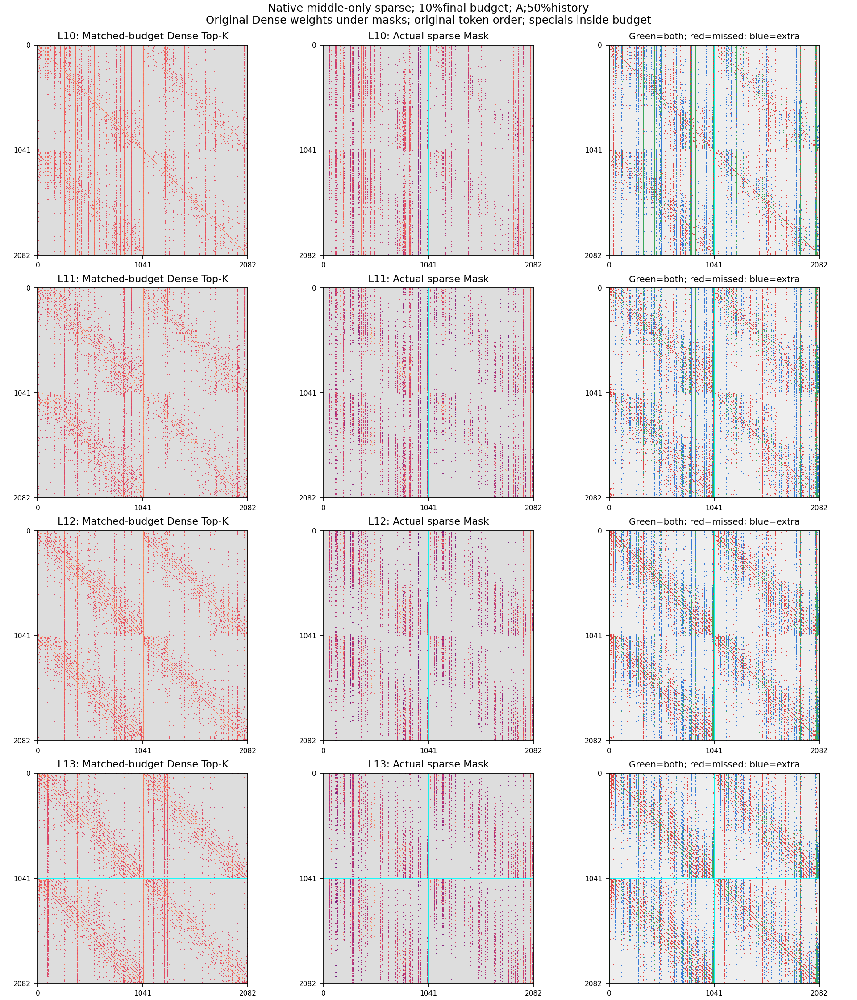
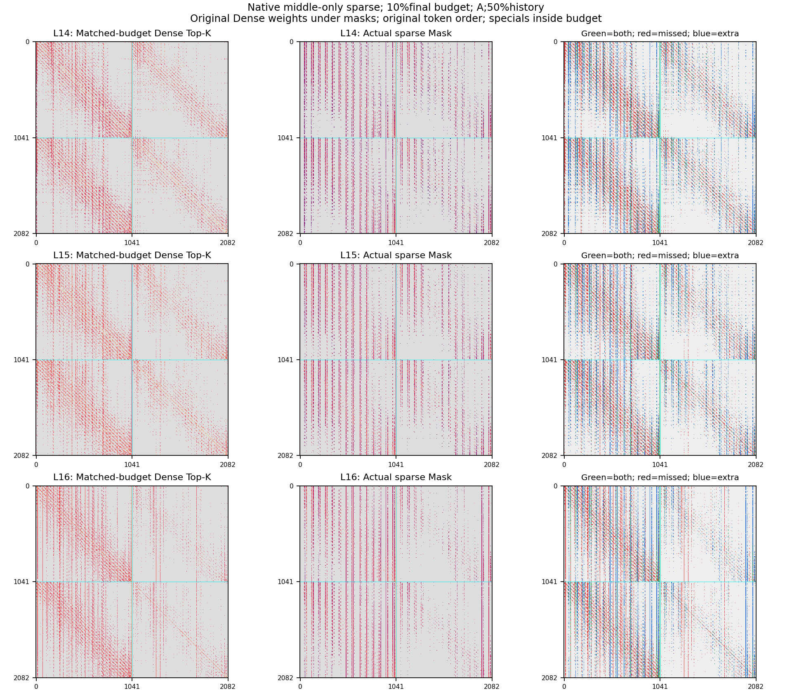
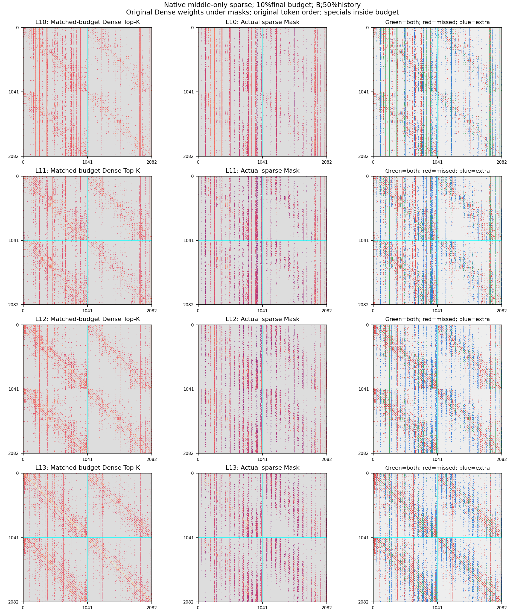
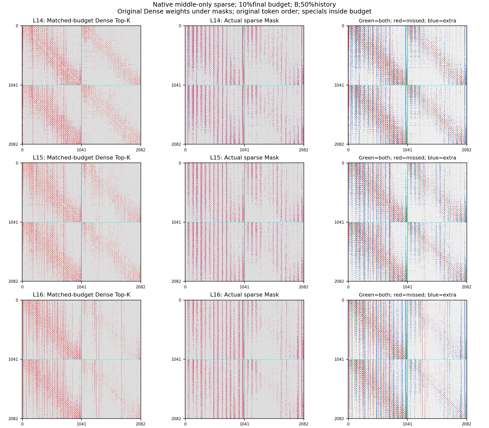
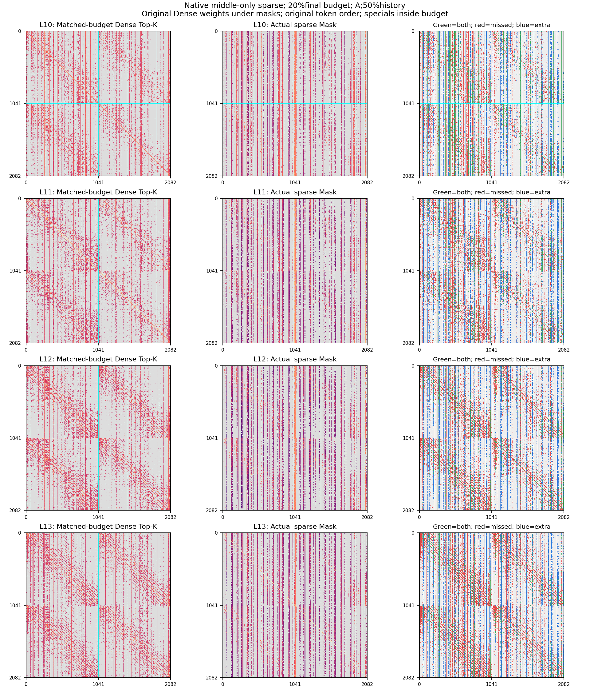
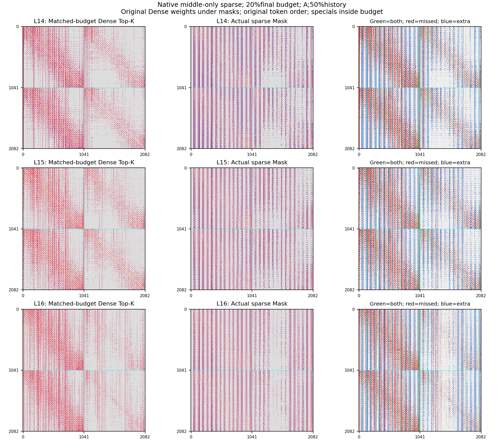
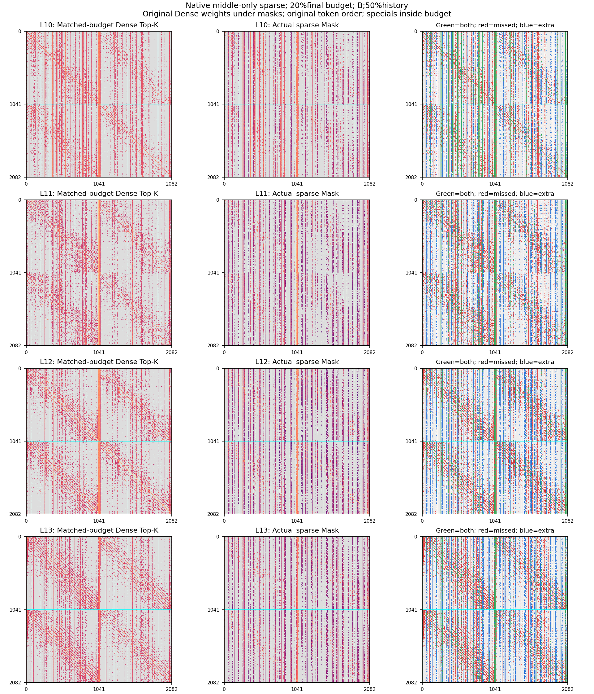
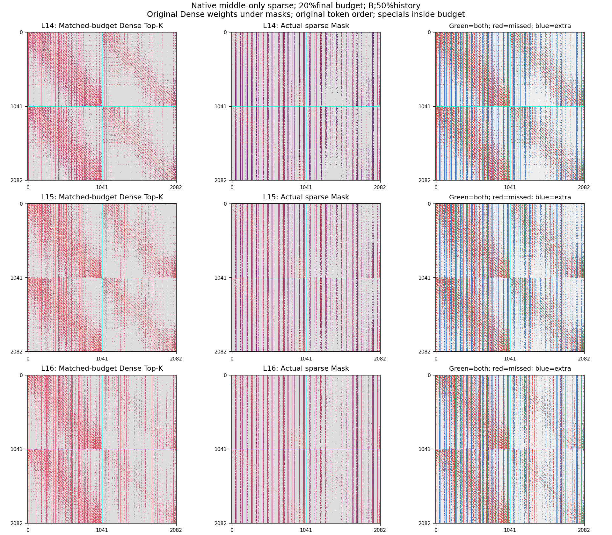

# Dense / region Attention / Dense: two-frame comparison

Chess frames0/10; Dense0–9, sparse10–16, Dense17–23. No Value support edges. Final10%/20%budgets include all specials. Results below average7middle layers, not a dataset accuracy result. Diagnostic runtimes are not speed benchmarks.

Primary table: fixed50%history. Exact/nearby recall targets the SAME Dense top10%patch Keys for both budgets (207targets/Query). Output error is relative Frobenius error before the attention output projection.

| Budget | Search | Scope | Exact % | r1 % | r2 % | r4 % | Local output error % | Trajectory error % |
|---|---|---|---:|---:|---:|---:|---:|---:|
| 10% | A | controlled | 28.02 | 85.85 | 90.22 | 95.28 | 43.44 | 43.44 |
| 10% | A | native | 27.57 | 85.44 | 89.90 | 95.02 | 47.46 | 54.78 |
| 10% | B | controlled | 28.98 | 88.59 | 92.88 | 97.24 | 41.41 | 41.41 |
| 10% | B | native | 28.44 | 88.23 | 92.71 | 97.22 | 45.90 | 51.65 |
| 20% | A | controlled | 35.76 | 97.67 | 98.75 | 99.71 | 31.49 | 31.49 |
| 20% | A | native | 34.85 | 97.49 | 98.61 | 99.69 | 36.21 | 38.99 |
| 20% | B | controlled | 35.77 | 97.72 | 98.77 | 99.71 | 31.43 | 31.43 |
| 20% | B | native | 35.23 | 97.60 | 98.73 | 99.67 | 35.63 | 39.01 |

## History ablation: same Dense inputs

| Budget | Search | Transfer | Exact % | r2 % | Output error % |
|---|---|---|---:|---:|---:|
| 10% | A | h0 | 19.72 | 86.62 | 44.82 |
| 10% | A | h25 | 24.21 | 89.10 | 43.84 |
| 10% | A | h50 | 28.02 | 90.22 | 43.44 |
| 10% | A | h100 | 32.44 | 89.66 | 47.71 |
| 10% | A | adaptive | 26.19 | 89.91 | 43.62 |
| 10% | B | h0 | 20.64 | 89.58 | 42.64 |
| 10% | B | h25 | 25.12 | 91.93 | 41.66 |
| 10% | B | h50 | 28.98 | 92.88 | 41.41 |
| 10% | B | h100 | 33.72 | 91.69 | 46.12 |
| 10% | B | adaptive | 27.13 | 92.66 | 41.62 |
| 20% | A | h0 | 22.50 | 98.38 | 33.57 |
| 20% | A | h25 | 30.10 | 98.73 | 31.80 |
| 20% | A | h50 | 35.76 | 98.75 | 31.49 |
| 20% | A | h100 | 43.32 | 98.23 | 31.37 |
| 20% | A | adaptive | 32.87 | 98.79 | 31.66 |
| 20% | B | h0 | 22.52 | 98.43 | 33.51 |
| 20% | B | h25 | 30.11 | 98.75 | 31.75 |
| 20% | B | h50 | 35.77 | 98.77 | 31.43 |
| 20% | B | h100 | 43.49 | 98.46 | 31.05 |
| 20% | B | adaptive | 32.88 | 98.82 | 31.61 |

## Per-layer primary A,50%history (controlled)

| Layer |10%exact |10%r2 |10%output error |20%exact |20%r2 |20%output error |
|---|---:|---:|---:|---:|---:|---:|
| 10 | 39.58 | 87.72 | 59.72 | 56.75 | 98.59 | 43.32 |
| 11 | 30.74 | 86.86 | 36.44 | 41.81 | 97.96 | 29.20 |
| 12 | 29.88 | 90.64 | 36.93 | 38.36 | 98.56 | 29.79 |
| 13 | 24.36 | 89.48 | 48.15 | 30.48 | 98.42 | 35.71 |
| 14 | 24.68 | 95.49 | 23.05 | 28.58 | 99.78 | 18.42 |
| 15 | 24.52 | 95.23 | 41.31 | 28.00 | 99.69 | 29.28 |
| 16 | 22.37 | 86.10 | 58.50 | 26.35 | 98.25 | 34.71 |

## Random-support sanity baseline

A uniformly random support with the SAME patch budget, without crossing frame boundaries in dilation. Large neighborhood recall is not meaningful without this baseline.

| Budget | Exact % | r1 % | r2 % | r4 % |
|---|---:|---:|---:|---:|
| 10% | 9.57 | 56.47 | 88.22 | 99.51 |
| 20% | 19.59 | 83.11 | 98.59 | 99.99 |

## Exact masks in original Dense matrix coordinates

Native masks come from the actual sparse trajectory; original Dense colors are a backdrop, not native sparse attention weights. The matched-budget Dense mask contains all specials plus198/406highest-probability patch Keys. No head Q/K averaging.

All per-layer/scenario results: all_layers.csv; averaged settings: settings.csv. Exact Key indices, not downsampled masks, are saved in each run masks.npz. No128-frame7Scenes accuracy or steady-state performance claim is made.
