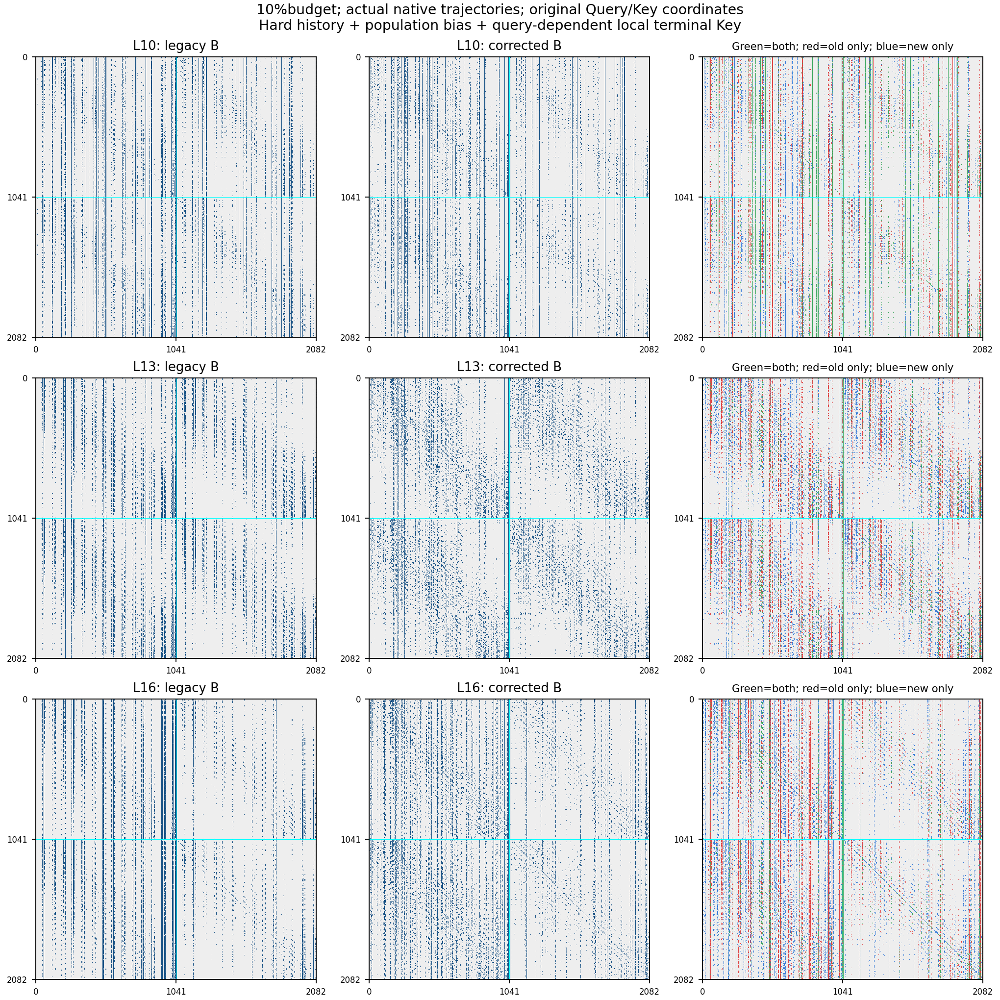
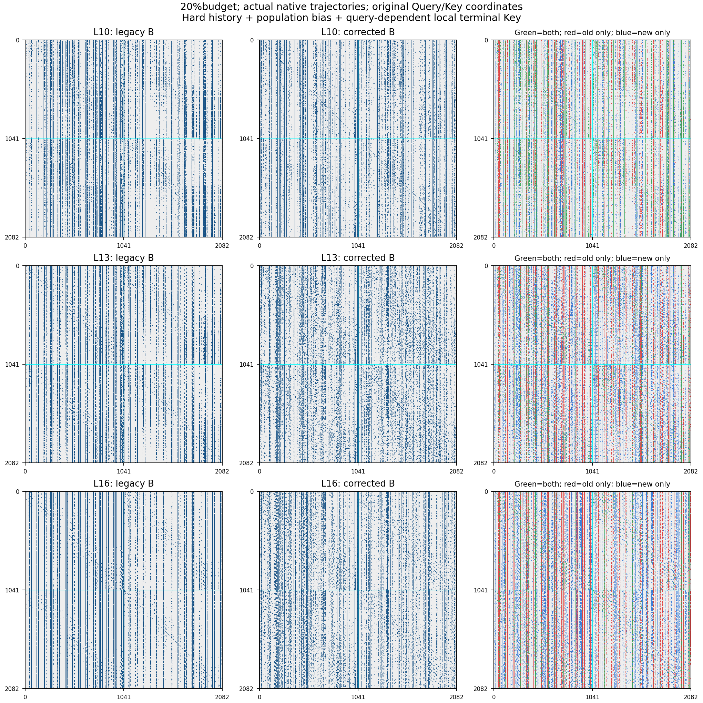

# 区域Attention修正与四组受控oracle

Chess seq-01第0/10帧；0–9及17–23层Dense，10–16为测试层。总边预算10%/20%，均含10个special Key；history transfer固定50%。受控表所有方法使用同一组原始Dense输入，各自递推history；冻结最佳成员对照除外。表内误差为7层分别计算的输出相对Frobenius误差的平均，不是NMSE，也不是数据集精度。

| 方法 |10%输出误差 |20%输出误差 |10%Top10精确召回 |20%Top10精确召回 |使用Dense oracle |
|---|---:|---:|---:|---:|---|
| 原版B | 41.41% | 31.43% | 28.98% | 35.77% | 否 |
| 仅硬保留history | 41.14% | 31.33% | 30.93% | 39.53% | 否 |
| 仅区域大小偏置 | 41.11% | 31.51% | 28.78% | 35.56% | 否 |
| 硬保留+大小偏置，仍取中心 | 40.86% | 31.37% | 30.76% | 39.40% | 否 |
| 精确group-mass oracle，仍取中心 | 42.15% | 31.61% | 28.25% | 35.60% | 是 |
| 硬保留+精确mass，仍取中心 | 41.82% | 31.46% | 30.30% | 39.45% | 是 |
| 修正版B：硬保留+大小偏置+局部选Key | 37.51% | 27.61% | 43.36% | 53.84% | 否 |
| 修正版A：硬保留+大小偏置+局部选Key | 38.29% | 27.63% | 42.62% | 53.82% | 否 |
| 硬保留+精确mass+Dense最佳成员oracle | 35.88% | 25.85% | 50.05% | 57.18% | 是 |
| 原版区域/历史固定，仅Dense最佳成员oracle | 37.63% | 27.60% | 42.13% | 51.15% | 是 |
| 精确mass区域/历史固定，仅Dense最佳成员oracle | 37.70% | 27.84% | 45.73% | 51.80% | 是 |
| 均匀真实Key | 57.02% | 37.66% | 9.31% | 18.95% | 否 |
| Dense attention TopK oracle | 38.82% | 26.09% | 95.65% | 100.00% | 是 |
| 单边删除影响力TopK diagnostic | 36.67% | 24.71% | 84.52% | 99.30% | 是 |

## 诊断结论与限制

- 旧版Mask逐bit复现，逐层输出误差复现到1e-5；不是更换输入/归一化后重新定义baseline。
- 硬保留history不再用coarse gate删除任何传入边，但这组样本上的单独收益很小。history仍是明确选出的50%mandatory子集，不是把所有旧边永久累计。
- 大小偏置使用未覆盖fine cells包含的真实token数量，仍不包含组内logit方差。精确mass按真实eligible成员的logsumexp排序；本例单独替换为精确mass没有降低输出误差，不能据聊天分析就认定coarse scoring是当前主因。
- 冻结区域/历史后改为Dense最佳成员，隔离了region→Key这一步；生产修正版只在已选fine小块内部做局部QK和逐头softmax后平均，不读取Dense分布。
- 单边影响力公式描述删除一条边的精确变化；按它选多个Key只是诊断heuristic，并不构成最优子集oracle。DenseTopK、influence均不可以当作快速生产实现。
- 这组同协议结果中DenseTopK好于uniform，不能直接套用另一个实验的NMSE均值比较。TopK仍未达到最小输出误差；影响力排序在本例更好。
- 四种改动存在交互作用，不能把误差简单拆成四项相加。半径2/4邻域召回不作为主要成功指标。
- 所有模式保留旧A/B结构便于对照；生产修正版默认A，B为可选。20%下A/B几乎等效；10%下B仍有小幅误差收益。

## 真正稀疏递推的GPU检查

以下为非oracle修正版在真实Dense/sparse/Dense主干中运行的结果。局部输出误差仍以当前层相同输入的Dense输出为参照，召回目标则为原始Dense轨迹。已逐Query验证所有history都保留、specials保留、预算精确且无重复、首个稀疏层输入与Dense逐bit一致。最后一组pose重复运行逐bit一致。

| 预算 |结构 |局部输出误差 |原始DenseTop10召回 |局部选Key额外QK/Query |
|---|---|---:|---:|---:|
| 10% | A | 37.54% | 41.93% | 407.8 |
| 10% | B | 36.76% | 42.62% | 411.9 |
| 20% | A | 28.05% | 53.33% | 833.9 |
| 20% | B | 28.04% | 53.36% | 834.1 |

局部成员QK包含最终胜出Key，当前最终执行会再算一次，额外成本必须计入；还包含coarse/intermediate搜索和池化成本。这里没有速度提升、128帧或7Scenes精度结论。

## 逐层受控修正版B

| 层 |10%旧误差 |10%新误差 |20%旧误差 |20%新误差 |
|---|---:|---:|---:|---:|
| 10 | 57.49% | 56.37% | 43.20% | 41.39% |
| 11 | 34.92% | 28.69% | 29.17% | 23.16% |
| 12 | 35.70% | 29.64% | 29.76% | 23.54% |
| 13 | 45.91% | 39.85% | 35.63% | 30.28% |
| 14 | 21.74% | 16.80% | 18.41% | 13.94% |
| 15 | 38.91% | 37.28% | 29.22% | 26.32% |
| 16 | 55.17% | 53.91% | 34.63% | 34.63% |

