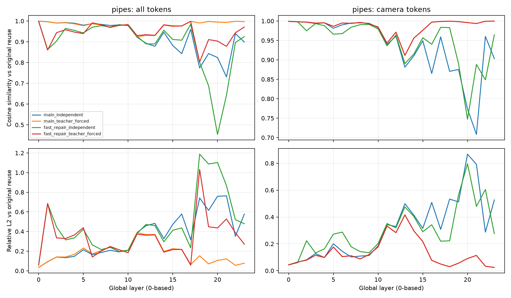
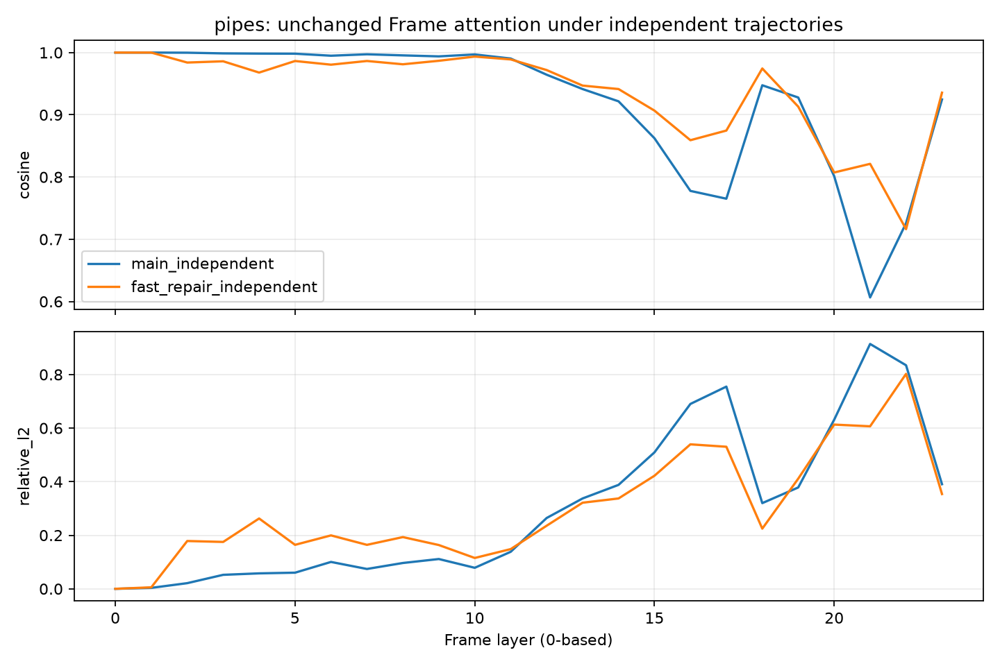
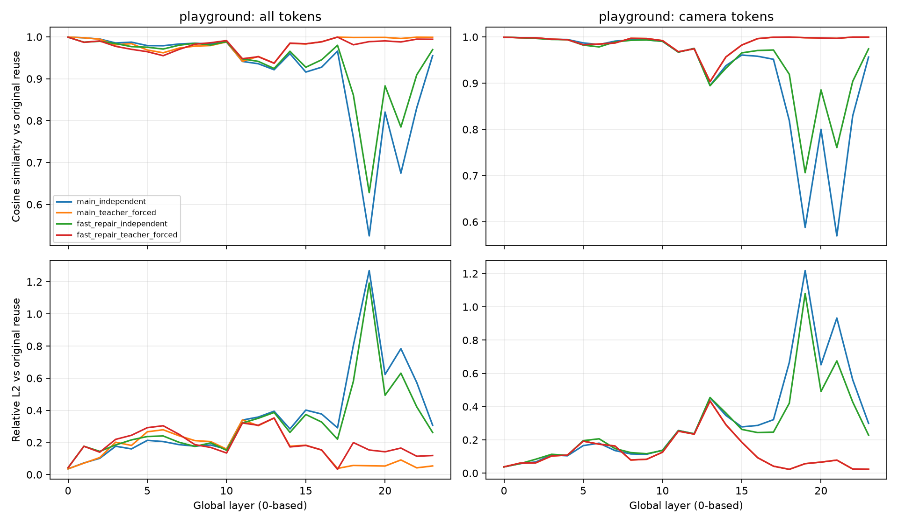
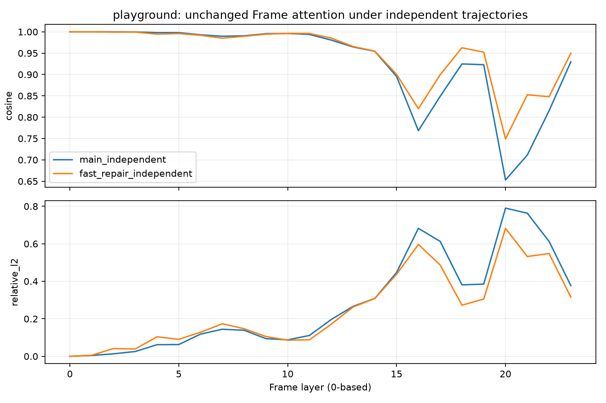
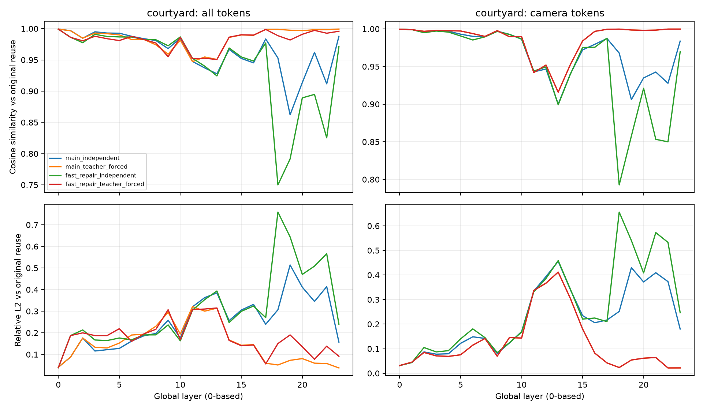
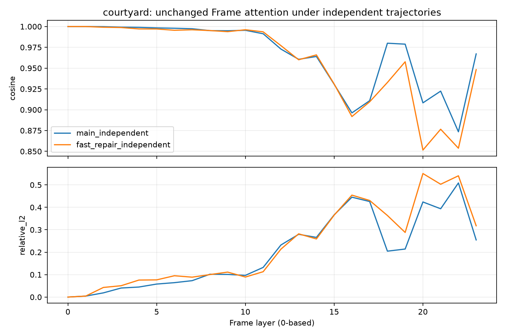

# 原版 reuse 与当前方法：逐层对比

固定同一 checkpoint、RGB 帧表、预处理张量；BF16、TF32 关闭、seed=0。只使用 GPU4/5/6。
这是 ETH3D 三个诊断场景，不能称为全11场景数据集结果。全部 token 参与，不是采样点近似。
Cosine = <current,reference>/(||current|| ||reference||)；相对 L2 = ||current-reference||/||reference||。
Global attention 输出为 Wo 之后；另保存 Wo 之前、Global block 输入和 Frame attention 的对比。
teacher_forced 每层替换 Global block 输入，但保留当前方法自己的历史链；它没有单独隔离历史误差。
原版输出的接近程度是诊断指标，不是几何精度的替代品。Frame 的同输入反事实行也不代表 Frame 输入相同。

## 同批保存预测的六指标（无额外模型前向）

AUC/F1 为百分数，ACC/Comp/CD 为米；CD=(ACC+Comp)/2，非平方距离。

| Scene | Method | AUC@3 % | AUC@30 % | ACC m | Comp m | CD m | F1 % |
|---|---|---:|---:|---:|---:|---:|---:|
| pipes | fast_repair_independent | 22.710623 | 83.589744 | 0.313127 | 0.237744 | 0.275435 | 70.296824 |
| pipes | history_unit_weight_independent | 9.157509 | 67.509158 | 0.382526 | 0.329852 | 0.356189 | 54.610072 |
| pipes | main_independent | 4.395604 | 60.842491 | 0.330584 | 0.398478 | 0.364531 | 34.400863 |
| pipes | matched_frontend_v2_independent | 30.402930 | 89.084249 | 0.256917 | 0.219370 | 0.238143 | 77.146552 |
| pipes | original | 21.611722 | 89.670330 | 0.242226 | 0.304045 | 0.273136 | 75.488195 |
| pipes | original_cluster_count | 28.205128 | 87.142857 | 0.216544 | 0.351877 | 0.284211 | 79.198077 |
| pipes | query32_only | 10.622711 | 69.450549 | 0.262765 | 0.397465 | 0.330115 | 57.816226 |
| pipes | source_anchored_only | 4.395604 | 61.941392 | 0.323383 | 0.479123 | 0.401253 | 35.688516 |
| pipes | source_anchored_query32 | 8.791209 | 74.358974 | 0.323652 | 0.357605 | 0.340629 | 44.118818 |
| pipes | uniform20_independent | 3.296703 | 68.644689 | 0.303266 | 0.561542 | 0.432404 | 47.191980 |
| pipes | uniform20_original_cluster_count | 21.978022 | 83.296703 | 0.194666 | 0.173522 | 0.184094 | 82.904690 |
| pipes | uniform20_original_cluster_count_lloyd2 | 21.611722 | 84.542125 | 0.253837 | 0.331015 | 0.292426 | 71.231911 |
| playground | fast_repair_independent | 6.854839 | 62.251344 | 0.411402 | 0.968680 | 0.690041 | 35.183301 |
| playground | main_independent | 1.881720 | 52.983871 | 0.502599 | 1.170506 | 0.836553 | 19.587395 |
| playground | original | 15.591398 | 74.045699 | 0.372135 | 0.721427 | 0.546781 | 69.193494 |
| playground | original_cluster_count | 7.594086 | 62.654570 | 0.393877 | 0.935582 | 0.664729 | 34.156291 |
| courtyard | fast_repair_independent | 7.396871 | 74.698909 | 0.331681 | 0.168972 | 0.250326 | 54.312878 |
| courtyard | main_independent | 11.237553 | 78.397345 | 0.446631 | 0.242219 | 0.344425 | 41.067767 |
| courtyard | original | 10.336652 | 81.522048 | 0.215030 | 0.145314 | 0.180172 | 75.360617 |
| courtyard | original_cluster_count | 8.440019 | 79.075391 | 0.649890 | 0.366265 | 0.508078 | 27.791237 |

### 3/11场景子集的等场景宏平均（不是全ETH3D）

| Method | AUC@3 % | AUC@30 % | ACC m | Comp m | CD m | F1 % |
|---|---:|---:|---:|---:|---:|---:|
| original | 15.846591 | 81.746026 | 0.276464 | 0.390262 | 0.333363 | 73.347435 |
| main_independent | 5.838293 | 64.074569 | 0.426605 | 0.603734 | 0.515169 | 31.685342 |
| fast_repair_independent | 12.320777 | 73.513332 | 0.352070 | 0.458465 | 0.405268 | 53.264334 |
| original_cluster_count | 14.746411 | 76.290939 | 0.420104 | 0.551241 | 0.485673 | 47.048535 |

上述ETH3D诊断的计时及原Dense加速：N/A。逐层保存/比较不能与暖机完整前向速度比较。
逐层诊断本身的六个几何指标为N/A并附原因；完整几何评测另存各运行的 saved_quality/。

## Global 逐层 cosine / 相对L2

每个单元格为 cosine / relative L2；层编号从0开始。

### pipes

| Layer | main_independent | main_teacher_forced | fast_repair_independent | fast_repair_teacher_forced |
|---:|---:|---:|---:|---:|
| 0 | 0.999414 / 0.034282 | 0.999414 / 0.034282 | 0.998542 / 0.059433 | 0.998542 / 0.059433 |
| 1 | 0.996337 / 0.092559 | 0.996398 / 0.091090 | 0.862549 / 0.683751 | 0.860341 / 0.685235 |
| 2 | 0.990391 / 0.140073 | 0.990143 / 0.141235 | 0.903192 / 0.446882 | 0.943772 / 0.334822 |
| 3 | 0.992556 / 0.133351 | 0.991637 / 0.140407 | 0.964534 / 0.314932 | 0.958043 / 0.328655 |
| 4 | 0.989379 / 0.147421 | 0.986370 / 0.167478 | 0.954893 / 0.335065 | 0.946563 / 0.364875 |
| 5 | 0.979950 / 0.214475 | 0.977405 / 0.232026 | 0.942550 / 0.423219 | 0.939398 / 0.439335 |
| 6 | 0.987187 / 0.164198 | 0.986546 / 0.172974 | 0.969865 / 0.263828 | 0.991190 / 0.139970 |
| 7 | 0.983851 / 0.186792 | 0.981059 / 0.204940 | 0.977531 / 0.216162 | 0.982213 / 0.201506 |
| 8 | 0.978615 / 0.208947 | 0.970433 / 0.242646 | 0.971197 / 0.238412 | 0.969043 / 0.247723 |
| 9 | 0.981344 / 0.192295 | 0.980530 / 0.197335 | 0.982832 / 0.196675 | 0.978814 / 0.214183 |
| 10 | 0.978059 / 0.208388 | 0.978186 / 0.209835 | 0.977767 / 0.209717 | 0.982933 / 0.184551 |
| 11 | 0.922142 / 0.389562 | 0.923503 / 0.388558 | 0.926446 / 0.379738 | 0.929679 / 0.373179 |
| 12 | 0.893012 / 0.458653 | 0.930904 / 0.368718 | 0.889991 / 0.471493 | 0.933970 / 0.362233 |
| 13 | 0.878208 / 0.483138 | 0.929861 / 0.369886 | 0.889689 / 0.461025 | 0.931274 / 0.366103 |
| 14 | 0.945642 / 0.327372 | 0.980391 / 0.197070 | 0.955581 / 0.295610 | 0.981803 / 0.189903 |
| 15 | 0.881722 / 0.473184 | 0.974276 / 0.225523 | 0.910996 / 0.412698 | 0.976264 / 0.216678 |
| 16 | 0.842644 / 0.578096 | 0.976252 / 0.217596 | 0.907575 / 0.436858 | 0.976209 / 0.217018 |
| 17 | 0.960024 / 0.316594 | 0.998196 / 0.063603 | 0.984537 / 0.234055 | 0.998386 / 0.057253 |
| 18 | 0.773888 / 0.742155 | 0.990378 / 0.153184 | 0.800928 / 1.187740 | 0.802580 / 1.033257 |
| 19 | 0.843185 / 0.614983 | 0.997614 / 0.070669 | 0.688277 / 1.087511 | 0.910500 / 0.448020 |
| 20 | 0.824138 / 0.758462 | 0.994645 / 0.105889 | 0.453988 / 1.102640 | 0.903390 / 0.436462 |
| 21 | 0.730605 / 0.763876 | 0.993570 / 0.121434 | 0.642281 / 0.868174 | 0.878118 / 0.527694 |
| 22 | 0.939270 / 0.350975 | 0.998509 / 0.055588 | 0.896655 / 0.519895 | 0.943524 / 0.387628 |
| 23 | 0.898731 / 0.578061 | 0.997198 / 0.077365 | 0.924803 / 0.479888 | 0.970958 / 0.270758 |

### playground

| Layer | main_independent | main_teacher_forced | fast_repair_independent | fast_repair_teacher_forced |
|---:|---:|---:|---:|---:|
| 0 | 0.999451 / 0.035634 | 0.999451 / 0.035634 | 0.999229 / 0.042766 | 0.999229 / 0.042766 |
| 1 | 0.997795 / 0.072332 | 0.997826 / 0.071038 | 0.987291 / 0.176332 | 0.987037 / 0.176126 |
| 2 | 0.994892 / 0.101299 | 0.994393 / 0.105910 | 0.989527 / 0.144406 | 0.990234 / 0.139429 |
| 3 | 0.985408 / 0.176316 | 0.981024 / 0.201289 | 0.984026 / 0.184309 | 0.977383 / 0.219165 |
| 4 | 0.987377 / 0.159864 | 0.983805 / 0.181474 | 0.976742 / 0.215823 | 0.970291 / 0.244630 |
| 5 | 0.979144 / 0.212914 | 0.968627 / 0.266337 | 0.975257 / 0.236954 | 0.964602 / 0.291969 |
| 6 | 0.978819 / 0.205543 | 0.962036 / 0.278935 | 0.970966 / 0.240309 | 0.955095 / 0.303952 |
| 7 | 0.982974 / 0.186435 | 0.973120 / 0.241755 | 0.980068 / 0.201075 | 0.970040 / 0.250751 |
| 8 | 0.984786 / 0.177050 | 0.977929 / 0.211394 | 0.984728 / 0.175362 | 0.982519 / 0.186440 |
| 9 | 0.983046 / 0.184042 | 0.979284 / 0.205324 | 0.980615 / 0.197202 | 0.985974 / 0.168921 |
| 10 | 0.987520 / 0.158725 | 0.987979 / 0.158467 | 0.988576 / 0.151078 | 0.991075 / 0.134201 |
| 11 | 0.941356 / 0.339381 | 0.941759 / 0.340161 | 0.947452 / 0.321253 | 0.947873 / 0.321158 |
| 12 | 0.935944 / 0.357966 | 0.953273 / 0.304335 | 0.941515 / 0.350353 | 0.952646 / 0.306940 |
| 13 | 0.921542 / 0.394318 | 0.937414 / 0.351345 | 0.924495 / 0.386642 | 0.937100 / 0.352365 |
| 14 | 0.959948 / 0.284103 | 0.984302 / 0.176513 | 0.965579 / 0.262595 | 0.985067 / 0.172178 |
| 15 | 0.915997 / 0.401421 | 0.983161 / 0.182759 | 0.927491 / 0.373906 | 0.983424 / 0.181340 |
| 16 | 0.927672 / 0.376782 | 0.988347 / 0.152242 | 0.945323 / 0.326892 | 0.988181 / 0.153346 |
| 17 | 0.966007 / 0.291063 | 0.999373 / 0.038281 | 0.979825 / 0.220046 | 0.999484 / 0.032545 |
| 18 | 0.759870 / 0.804317 | 0.998403 / 0.057145 | 0.861256 / 0.580342 | 0.981120 / 0.199348 |
| 19 | 0.525149 / 1.269710 | 0.998542 / 0.054840 | 0.628245 / 1.192235 | 0.988664 / 0.152903 |
| 20 | 0.820625 / 0.623207 | 0.998629 / 0.053241 | 0.883116 / 0.493806 | 0.990370 / 0.141950 |
| 21 | 0.674898 / 0.783718 | 0.996160 / 0.091122 | 0.784951 / 0.631206 | 0.987878 / 0.165002 |
| 22 | 0.830802 / 0.573078 | 0.999237 / 0.041915 | 0.909514 / 0.421559 | 0.994554 / 0.114108 |
| 23 | 0.955055 / 0.307508 | 0.998962 / 0.053783 | 0.969519 / 0.262304 | 0.994276 / 0.118606 |

### courtyard

| Layer | main_independent | main_teacher_forced | fast_repair_independent | fast_repair_teacher_forced |
|---:|---:|---:|---:|---:|
| 0 | 0.999170 / 0.040752 | 0.999170 / 0.040752 | 0.999259 / 0.038597 | 0.999259 / 0.038597 |
| 1 | 0.996783 / 0.087625 | 0.996656 / 0.087984 | 0.986212 / 0.187437 | 0.986072 / 0.187113 |
| 2 | 0.984727 / 0.176097 | 0.984741 / 0.176025 | 0.977494 / 0.213351 | 0.980463 / 0.199887 |
| 3 | 0.994891 / 0.115862 | 0.992914 / 0.133416 | 0.990883 / 0.166838 | 0.987776 / 0.187313 |
| 4 | 0.992919 / 0.121994 | 0.991866 / 0.130000 | 0.987466 / 0.164335 | 0.983880 / 0.187287 |
| 5 | 0.992667 / 0.127949 | 0.990001 / 0.152534 | 0.986735 / 0.176035 | 0.980932 / 0.219118 |
| 6 | 0.987757 / 0.161405 | 0.982608 / 0.189856 | 0.986594 / 0.167403 | 0.987568 / 0.160342 |
| 7 | 0.983921 / 0.186077 | 0.982813 / 0.193444 | 0.982689 / 0.190405 | 0.982688 / 0.194694 |
| 8 | 0.981007 / 0.197238 | 0.974087 / 0.230559 | 0.982175 / 0.190559 | 0.976967 / 0.216446 |
| 9 | 0.968059 / 0.258480 | 0.959123 / 0.295183 | 0.972587 / 0.236622 | 0.955059 / 0.306954 |
| 10 | 0.984779 / 0.175650 | 0.981493 / 0.194320 | 0.986747 / 0.163117 | 0.986056 / 0.167859 |
| 11 | 0.947489 / 0.320363 | 0.947265 / 0.321322 | 0.952514 / 0.305184 | 0.951842 / 0.307484 |
| 12 | 0.937103 / 0.362900 | 0.954622 / 0.300332 | 0.939954 / 0.353843 | 0.952648 / 0.310160 |
| 13 | 0.927743 / 0.384814 | 0.950715 / 0.314221 | 0.924372 / 0.393579 | 0.950580 / 0.314985 |
| 14 | 0.966749 / 0.256558 | 0.985940 / 0.167129 | 0.969020 / 0.247679 | 0.986333 / 0.164806 |
| 15 | 0.952316 / 0.305474 | 0.989883 / 0.142371 | 0.954694 / 0.299472 | 0.990167 / 0.140286 |
| 16 | 0.945290 / 0.331516 | 0.989379 / 0.145411 | 0.948179 / 0.323996 | 0.989639 / 0.143643 |
| 17 | 0.983484 / 0.239648 | 0.998718 / 0.059427 | 0.977055 / 0.270435 | 0.998725 / 0.056123 |
| 18 | 0.953035 / 0.306590 | 0.998725 / 0.051220 | 0.749960 / 0.758706 | 0.988721 / 0.150312 |
| 19 | 0.862147 / 0.514082 | 0.997485 / 0.072763 | 0.791494 / 0.643939 | 0.981852 / 0.190297 |
| 20 | 0.913686 / 0.411275 | 0.996816 / 0.080719 | 0.889211 / 0.470360 | 0.990950 / 0.135513 |
| 21 | 0.961999 / 0.345272 | 0.998230 / 0.059561 | 0.894776 / 0.508754 | 0.997206 / 0.077465 |
| 22 | 0.911681 / 0.413766 | 0.998318 / 0.058080 | 0.825243 / 0.565799 | 0.992659 / 0.138162 |
| 23 | 0.987546 / 0.157356 | 0.999301 / 0.037485 | 0.970997 / 0.240558 | 0.995809 / 0.091468 |

## 7Scenes heads128 配对完整前向计时

仅heads场景128帧；不是全7场景平均。GPU6独占，BF16，1次暖机+3次计时，中位数。
SAF3R为原版Top4，lazy first-correspondence-head Top-K；不是论文DINO feature Top-K。
包含初始化、聚类、路由、历史及重排；不包括图像加载和模型权重加载。

| Method | Median full-forward s | Speedup vs Dense | Peak allocated GiB |
|---|---:|---:|---:|
| dense | 17.051636 | 1.0000x | 14.3586 |
| saf3r | 8.591721 | 1.9847x | 14.6143 |
| main | 9.353301 | 1.8231x | 15.3730 |
| original_cluster_count | 9.409061 | 1.8123x | 15.4908 |

## 失败诊断保留

- pipes/matched_frontend_independent/status.json: Invalid diagnostic configuration: Query group32 with attention tile64; rejected before model forward；六指标N/A，未执行有效前向。
- pipes/matched_frontend_teacher_forced/status.json: Invalid diagnostic configuration: Query group32 with attention tile64; rejected before model forward；六指标N/A，未执行有效前向。
