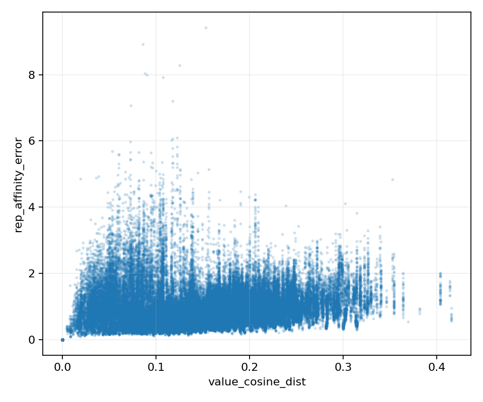
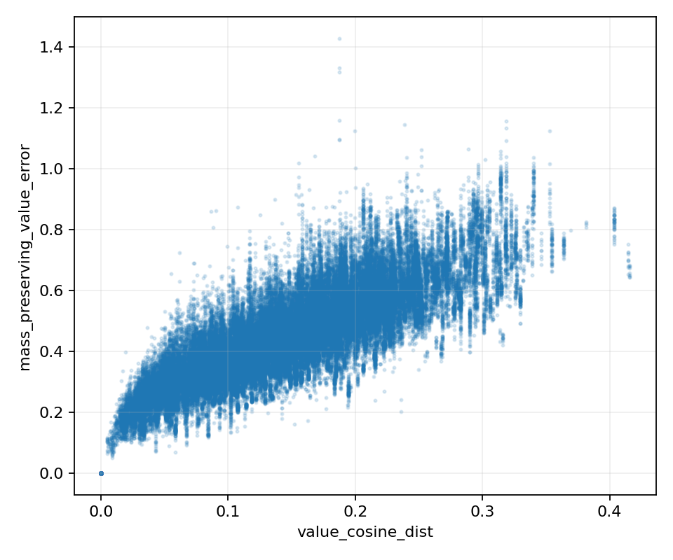
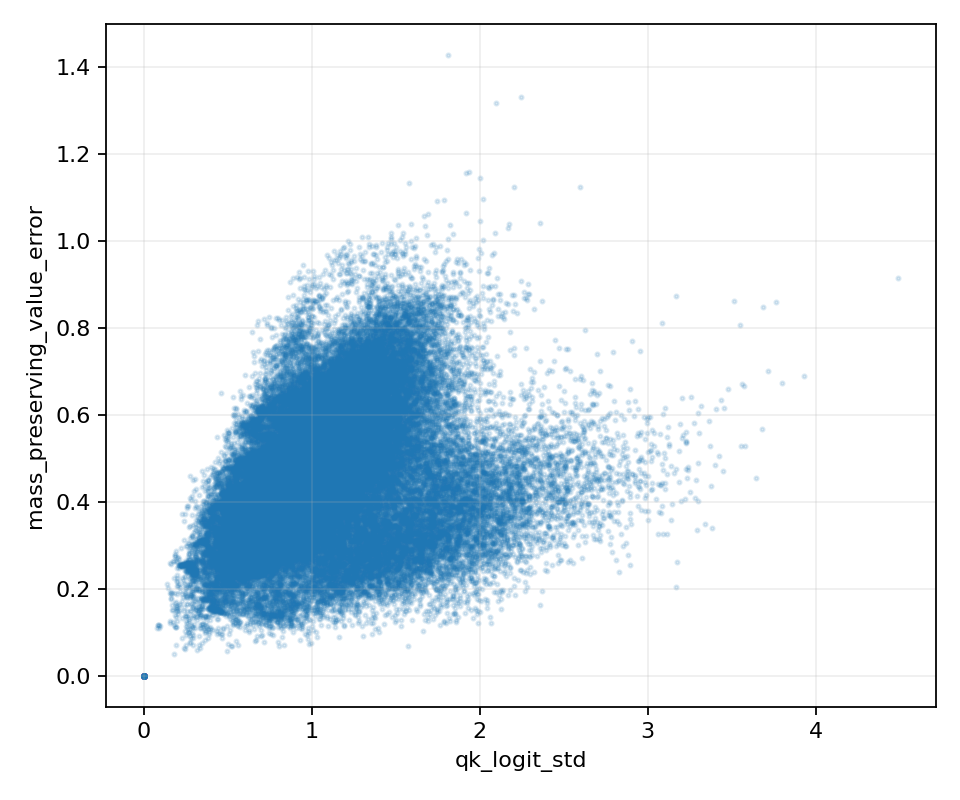
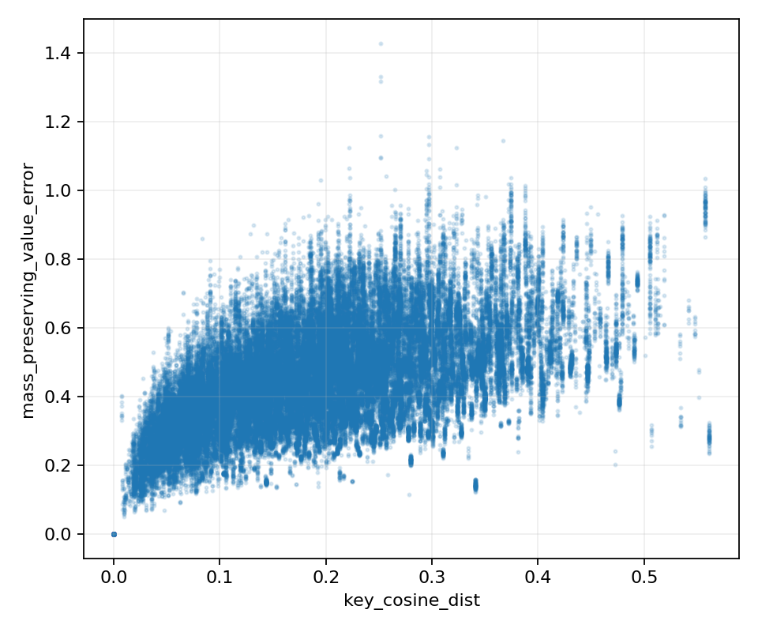

# Unified Next-Round Analysis

Upstream:0856426c0537195255946b356f027416d349be5b. Diagnostic corrections are recorded in git; production files unchanged.

Stage0: original tests9passed/1BF16 sparse failure; diagnostic compatibility10passed; expanded suite12passed. Six requested scripts passed py_compile.

All five Stage1 categories completed. Chess/Fire/RedKitchen, seq-01, frames0/20, original checkpoint and preprocessing. No Stage2 or model tuning.

All values below are diagnostic, not pose/reconstruction quality evaluations: AUC@3,AUC@30,ACC,Comp,CD,F1 and paired Dense speedup are N/A (not evaluated). Each run has quality.json/quality.md.

Recall and mass tables use percentages. Tables aggregate three scenes equally. Dense reuse holds head index fixed; it is not a best cross-layer head-matching oracle. Two-frame results do not establish128-frame accuracy.

Dense targets/candidates are patch-only20% (integer rounding); sparse20% total budget includes special keys, so its patch-only candidate density is about19.5–19.6%. Pipeline diagnostic targets are full patch QK on the same sparse trajectory, not the original Dense network trajectory.

## 1. Dense adjacent-layer reuse ceiling

| Pair | Prev Top20 recall % | Prev Top40 recall % | Prev Top50 recall % | Prev Top80 recall % | Prev Top20 mass % |
| --- | --- | --- | --- | --- | --- |
| L8→L9 | 38.191 | 61.664 | 70.555 | 90.698 | 37.373 |
| L9→L10 | 35.926 | 59.336 | 68.634 | 90.060 | 37.909 |
| L10→L11 | 30.475 | 52.273 | 61.721 | 86.291 | 40.565 |
| L11→L12 | 36.421 | 58.887 | 67.877 | 89.350 | 45.917 |
| L12→L13 | 31.925 | 53.992 | 63.170 | 86.508 | 39.919 |
| L13→L14 | 35.708 | 58.524 | 67.459 | 88.802 | 45.604 |
| L14→L15 | 43.255 | 67.168 | 75.739 | 93.934 | 51.523 |
| L15→L16 | 34.206 | 58.202 | 67.813 | 88.820 | 36.825 |
| L16→L17 | 24.834 | 47.631 | 58.284 | 86.146 | 23.942 |

Middle subset is exactly L10→11 through L14→15. Candidate retention is a fraction of ALL patch keys, not a fraction of the final20% mask.

| candidate_retention | recall | attention_mass_coverage | key_saliency_control_recall | key_saliency_control_mass | same_prefix_jaccard |
| --- | --- | --- | --- | --- | --- |
| 0.200 | 35.557 | 44.706 | 25.512 | 28.252 | 23.117 |
| 0.300 | 47.831 | 55.084 | 36.458 | 39.166 | 23.117 |
| 0.400 | 58.169 | 63.849 | 46.770 | 49.433 | 23.117 |
| 0.500 | 67.193 | 71.537 | 56.618 | 59.076 | 23.117 |
| 0.800 | 88.977 | 90.291 | 84.027 | 84.978 | 23.117 |

Even high recall from80% candidates cannot be described as80% useful reuse inside a20% budget. Same-size20% overlap is the meaningful equal-budget observation.

## 2. Current History pipeline

| layer | previous_full | history_candidates | history_selected | final_support |
| --- | --- | --- | --- | --- |
| 9 | 20.127 | 0.000 | 0.000 | 20.061 |
| 10 | 19.818 | 0.000 | 0.000 | 19.687 |
| 11 | 18.863 | 0.000 | 0.000 | 18.951 |
| 12 | 18.441 | 0.000 | 0.000 | 18.711 |
| 13 | 18.143 | 0.010 | 0.009 | 18.230 |
| 14 | 18.378 | 0.013 | 0.013 | 18.628 |
| 15 | 19.217 | 0.181 | 0.174 | 19.446 |
| 16 | 14.875 | 0.442 | 0.346 | 15.300 |

Candidate density (%) for the SAME four supports:

| layer | previous_full | history_candidates | history_selected | final_support |
| --- | --- | --- | --- | --- |
| 9 | 19.595 | 0.000 | 0.000 | 19.595 |
| 10 | 19.595 | 0.000 | 0.000 | 19.595 |
| 11 | 19.595 | 0.000 | 0.000 | 19.595 |
| 12 | 19.595 | 0.000 | 0.000 | 19.592 |
| 13 | 19.592 | 0.004 | 0.004 | 19.578 |
| 14 | 19.578 | 0.006 | 0.006 | 19.539 |
| 15 | 19.539 | 0.084 | 0.075 | 19.513 |
| 16 | 19.513 | 0.252 | 0.177 | 19.513 |

Current diagnostic patch-attention mass coverage (%):

| layer | previous_full | history_candidates | history_selected | final_support |
| --- | --- | --- | --- | --- |
| 9 | 19.952 | 0.000 | 0.000 | 19.942 |
| 10 | 19.597 | 0.000 | 0.000 | 19.549 |
| 11 | 18.948 | 0.000 | 0.000 | 18.880 |
| 12 | 17.559 | 0.000 | 0.000 | 18.100 |
| 13 | 17.015 | 0.007 | 0.007 | 17.421 |
| 14 | 16.943 | 0.017 | 0.017 | 17.664 |
| 15 | 19.915 | 0.197 | 0.190 | 19.722 |
| 16 | 14.905 | 0.511 | 0.411 | 15.289 |

Loss decomposition (percentage points):

| layer | bank_loss_pp | selection_loss_pp |
| --- | --- | --- |
| 9 | 20.127 | 0.000 |
| 10 | 19.818 | 0.000 |
| 11 | 18.863 | 0.000 |
| 12 | 18.441 | 0.000 |
| 13 | 18.133 | 0.001 |
| 14 | 18.365 | 0.000 |
| 15 | 19.036 | 0.007 |
| 16 | 14.433 | 0.097 |

H1/H2/H3 may coexist and vary by layer. Compare both absolute and relative drops; a candidate pool of only a fraction of1% cannot have high full Top20 recall. Sparse-trajectory targets and Dense-trajectory targets must not be subtracted as if identical.

## 3. Query-group granularity

Top20 recall (%)

| source_layer | target_layer | 32 | 16 | 8 | 4 | 1 |
| --- | --- | --- | --- | --- | --- | --- |
| 9 | 10 | 43.015 | 43.259 | 43.590 | 43.887 | 44.348 |
| 10 | 11 | 36.126 | 37.113 | 38.322 | 39.444 | 41.601 |
| 11 | 12 | 35.561 | 38.017 | 39.799 | 40.838 | 42.599 |
| 12 | 13 | 34.682 | 38.547 | 41.197 | 42.628 | 44.603 |
| 13 | 14 | 36.248 | 42.705 | 46.554 | 48.179 | 49.728 |
| 14 | 15 | 38.738 | 43.871 | 47.528 | 49.545 | 51.955 |

Current attention mass coverage (%)

| source_layer | target_layer | 32 | 16 | 8 | 4 | 1 |
| --- | --- | --- | --- | --- | --- | --- |
| 9 | 10 | 45.562 | 46.123 | 46.802 | 47.449 | 48.658 |
| 10 | 11 | 49.370 | 53.038 | 56.584 | 59.131 | 62.048 |
| 11 | 12 | 54.265 | 58.146 | 60.665 | 61.980 | 63.659 |
| 12 | 13 | 51.858 | 56.687 | 59.428 | 60.725 | 62.135 |
| 13 | 14 | 63.822 | 70.035 | 73.069 | 74.347 | 75.499 |
| 14 | 15 | 53.792 | 59.232 | 62.544 | 64.243 | 66.083 |

| scene | recall_group32 | recall_per_query | recall_gain_pp | mass_gain_pp |
| --- | --- | --- | --- | --- |
| chess | 37.216 | 45.350 | 8.134 | 9.544 |
| fire | 37.035 | 45.474 | 8.440 | 10.052 |
| redkitchen | 37.934 | 46.593 | 8.660 | 10.110 |

All groups use20% candidates, and head sharing remains fixed. Per-query here still means HEAD-SHARED support, not per-head Top20. Smaller groups alone cannot remove head-sharing loss.

## 4. Value-cluster compressibility

### Metric ranking

| signal | rank_correlation_with_weighted_error | precision_at_fraction | recall_at_fraction |
| --- | --- | --- | --- |
| value_rel_l2 | 0.433 | 0.308 | 0.308 |
| value_cosine_dist | 0.431 | 0.305 | 0.305 |
| key_rel_l2 | 0.342 | 0.279 | 0.279 |
| key_cosine_dist | 0.342 | 0.277 | 0.277 |
| qk_logit_std | 0.246 | 0.280 | 0.280 |
| rep_affinity_error | 0.272 | 0.291 | 0.291 |

Best measured Precision@20% signal: **value_rel_l2**. This is a diagnostic ranking, not a validated deployment threshold.

Raw value_rel_l2/key_rel_l2 are ratios of summed squared L2 energies (no square root), despite their names. Spearman ranks average ties. Reference error is importance × mass-preserving relative Value error; it does NOT measure the affinity/mass error itself.

Descriptive low/high quadrants: bottom25% Value cosine distortion AND top25% affinity error, per scene. These are analysis quantiles, NOT tuned production thresholds.

| scene | pairs | low_value_q25 | high_affinity_q75 | bad_pairs | fraction_all | fraction_low_value |
| --- | --- | --- | --- | --- | --- | --- |
| chess | 25344 | 0.105 | 1.242 | 1961 | 0.077 | 0.308 |
| fire | 25344 | 0.094 | 1.188 | 2175 | 0.086 | 0.343 |
| redkitchen | 25344 | 0.096 | 1.126 | 1869 | 0.074 | 0.295 |

| scene | layer | query_group | cluster | cluster_size | value_cosine_dist | rep_affinity_error | mass_preserving_value_error | selected_state |
| --- | --- | --- | --- | --- | --- | --- | --- | --- |
| chess | 14 | 65 | 332 | 7 | 0.086 | 8.916 | 0.860 | rep |
| chess | 14 | 65 | 145 | 5 | 0.088 | 8.035 | 0.806 | rep |
| chess | 14 | 65 | 283 | 7 | 0.090 | 8.001 | 0.862 | rep |
| chess | 14 | 65 | 127 | 5 | 0.073 | 7.075 | 0.690 | rep |
| chess | 14 | 57 | 182 | 8 | 0.053 | 5.691 | 0.375 | rep |
| fire | 14 | 62 | 50 | 4 | 0.073 | 5.980 | 0.602 | rep |
| fire | 14 | 14 | 13 | 9 | 0.082 | 5.661 | 0.441 | rep |
| fire | 14 | 28 | 50 | 4 | 0.073 | 5.651 | 0.515 | rep |
| fire | 14 | 63 | 50 | 4 | 0.073 | 5.443 | 0.552 | rep |
| fire | 14 | 31 | 50 | 4 | 0.073 | 5.430 | 0.629 | rep |
| redkitchen | 14 | 46 | 124 | 6 | 0.095 | 5.643 | 0.466 | rep |
| redkitchen | 14 | 13 | 86 | 9 | 0.060 | 5.600 | 0.519 | rep |
| redkitchen | 14 | 10 | 86 | 9 | 0.060 | 5.574 | 0.570 | rep |
| redkitchen | 14 | 44 | 86 | 9 | 0.060 | 5.310 | 0.453 | rep |
| redkitchen | 14 | 12 | 124 | 6 | 0.095 | 5.219 | 0.506 | rep |

Current Rep / exact-like state median metrics:

| selected_state | value_cosine_dist | key_cosine_dist | qk_logit_std | rep_affinity_error | mass_preserving_value_error | pairs |
| --- | --- | --- | --- | --- | --- | --- |
| exact_like | 0.000 | 0.000 | 0.000 | 0.000 | 0.000 | 267 |
| other | 0.142 | 0.044 | 0.757 | 0.730 | 0.222 | 4 |
| rep | 0.146 | 0.194 | 1.043 | 0.804 | 0.448 | 75761 |

The rep/exact_like labels are support-derived inferred states, not randomized treatments. Correlations and state differences do not establish that switching the criterion will improve AUC/F1.

## 5. History reuse scaling

| reuse_ratio | history_items | fine_items | exploration_ms_window | solver_ms_window | total_ms_window | projected_all_windows_ms | peak_allocated_mib |
| --- | --- | --- | --- | --- | --- | --- | --- |
| 0.000 | 0 | 26009 | 0.140 | 2.045 | 2.185 | 1137.113 | 13.101 |
| 0.250 | 6502 | 26009 | 0.134 | 2.248 | 2.382 | 1239.739 | 21.088 |
| 0.500 | 13004 | 26009 | 0.133 | 2.251 | 2.384 | 1240.805 | 23.123 |
| 0.750 | 19507 | 26009 | 0.130 | 2.237 | 2.367 | 1232.011 | 26.745 |
| 0.800 | 20807 | 26009 | 0.131 | 2.249 | 2.380 | 1238.673 | 27.707 |

The x-axis is synthetic History CANDIDATE ITEMS / budget, not measured accepted History reuse. Fine exploration table is fixed. Projected time covers ONLY exploration-state construction + joint objective/dual solver; not pooling, packing, evidence or full model.

The structural requirement more reuse → less exploration work → cheaper mask construction is **not implemented**: all Fine exploration items are constructed for every History pool size. Timing measures the cost of this structure, not a deployed speedup.

## 6. Causal conclusions

### History

**Primary case H1, with a bootstrap limitation consistent with H3; H2 is secondary in these clips.** Previous-full recall is14.875–20.127%, whereas History candidates collapse to0% inL9–L12 and only0.442% atL16. L16 loses14.433pp at candidate construction versus0.097pp at selection. Relative selection loss atL16 is not zero, but it is not the dominant absolute loss.

The candidate pool density is0–0.252% of patch keys, versus about19.5% for the previous full support. Tiny History ratios are therefore not simply evidence that adjacent-layer Dense relations do not exist.

Code evidence: L0 labels all representative keys non-genuine; subsequent History stores only `real` edges (retained History or Exact expansion). A high-weight representative QK is still excluded. Early Rep-only layers have no genuine seed, hence no History candidate and zero explicit-relation coverage. Later Exact expansion slowly introduces candidates. This explains the observed near-empty pipeline without changing the production scoring formula.

H3 qualification: previous-full support is itself only near its roughly20% density, not a high-quality oracle support. Candidate starvation is established; improving the candidate pool alone is not proven sufficient for end-to-end accuracy. H4 is not supported because high final-support recall was not observed.

Dense reuse is real but modest: middle Top20→Top20 recall35.557% versus25.512% saliency control and20% random expectation. Full L8–L17 Top20 recall averages34.549%; Top50 gives66.806%, Top80 gives88.957%. Thus50–80% RECALL can be reached only with wider candidates for many pairs;50–80% accepted reuse inside the final20% budget is NOT established.

Query grouping is another measurable limitation: group32→per-query improves recall8.134/8.440/8.660pp on Chess/Fire/RedKitchen and mass9.544/10.052/10.110pp. This is a Dense offline control; it is not a causal measurement on the sparse trajectory and cannot be attributed solely to the History scorer.

### Rep / Exact

Value similarity alone does not guarantee representative QK affinity accuracy. The descriptive low-Value/high-affinity quadrant contains6005/76032 sampled pairs (7.90% overall), and29.5–34.3% of each scene's low-Value quartile. Low here is relative to the sampled distribution (cosine thresholds0.094–0.105), not an absolute near-identity guarantee.

Selected states are75761 Rep,267 exact-like,4 other:99.64% Rep among these sampled important pairs. Rep median mass-preserving relative contribution error is0.448. This supports concern about aggressive representative use, but does not prove that reallocating the fixed budget to Exact will improve quality.

Exact-like medians are confounded by144 singleton clusters out of267; do not claim their zero median errors demonstrate a randomized Exact advantage. These samples are top64 clusters per group and layer, not all clusters or independent scene samples.

Value squared-L2 has the best measured rank correlation0.433 and Precision@20%=30.78%. Among the requested Attention-side candidates, affinity error has best precision29.12%, Key squared-L2 has best rank correlation0.342; QK std precision28.05%. No Attention-side signal wins consistently over Value for this MASS-PRESERVING reference.

The reference deliberately assigns true cluster mass and therefore removes affinity/mass error. This experiment cannot establish the best predictor of total Attention-output error or conclude that population correction is wrong. Keep population compensation out of scope. The old prototype advantage hypothesis H-D remains UNRESOLVED: no old-prototype matched causal ablation was run.

Efficiency H-E is supported for the benchmarked objective/solver: Fine items remain26009 at every History size. Exploration stays0.130–0.140ms/window, total2.185ms atzero History versus2.380ms at80% History candidates; projected subtotal1.137s→1.239s (~8.9% increase), peak13.10→27.71MiB. The implementation does not yet reduce unresolved exploration work with reuse. This does not measure actual accepted reuse or whole mask construction.

## 7. What NOT to change yet

- No production History scoring, Value clustering, Rep/Exact logic, population compensation or query-group size changed.

- Do not infer improved pose/reconstruction from a diagnostic support metric.

- Do not use7Scenes test AUC/F1 or these descriptive quantiles to tune a production threshold.

- Do not call the two-frame fixed-head overlap a128-frame geometric-relation theorem.

## 8. Next end-to-end experiment

**One History module change only: History evidence/candidate eligibility.** Permit the real representative Key whose QK was actually executed to supply a single-edge History candidate, using its existing population-divided single-edge salience, rather than restricting eligibility to retained History/Exact members. Keep the current gain formula, budget solver, total20% retention, Value grouping, population correction and group32 fixed. Coverage should consume the same newly eligible single-edge evidence; do not independently retune its formula. This tests H1 and the observed seed starvation, not a guarantee of improved accuracy.

**Rep/Exact production change: none recommended yet.** Current cheap Key/QK signals did not beat Value under the prescribed reference. If a separate tiny-clip diagnostic ablation is approved, use the documented affinity-error oracle to test affinity-related failure independently, with the same clusters/budget and explicit total-output error measurement. It is not an accelerator and should not be combined with the History change in the first causal test.

No Stage2 has been executed. Any eventual deployment criterion/threshold must be selected on independent calibration, frozen, and then evaluated with all six quality metrics on7Scenes128.
